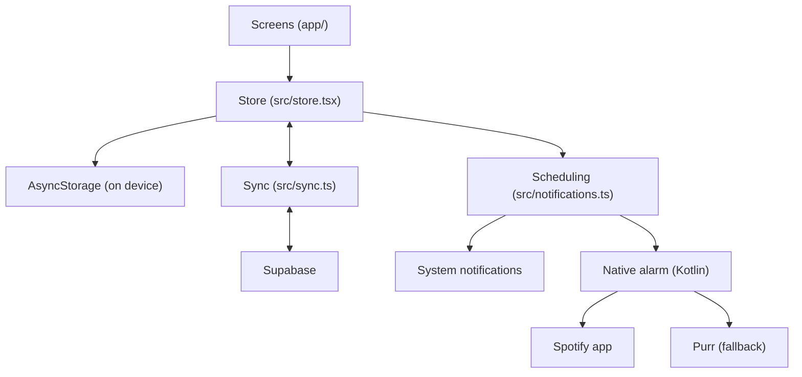

<p align="center">
  
</p>

<h1 align="center">Tomorrow</h1>

<p align="center">Your daily planning app with your chosen cat companion.</p>

Every evening, a pixel cat asks what you're doing tomorrow. You write it down, and the cat reminds you when it's time. Your tasks are saved on your phone first, so the app works offline and without an account.

- [Features](#features)
- [Tech stack](#tech-stack)
- [Why it's built this way](#why-its-built-this-way)
- [How it works](#how-it-works)
- [Getting started](#getting-started)
- [Ongoing](#ongoing)
- [To be implemented](#to-be-implemented)

## Features

### Planning

- **Three views:** Tomorrow, Today and Later. Later has a 14-day strip and a month calendar for planning further ahead.
- **Task details:** add notes of up to 2,000 characters.
- **Reminders:** set a time on any task.
- **Repeating tasks:** choose the weekdays and an optional end date.
- **Flexible edits:** change one day of a repeating task, or that day and all future days.
- **Flexible deletes:** remove one day, a span of days or the whole series.
- **Undo:** available after editing or deleting a task.

### Daily nudge

- The cat asks about tomorrow at a time you choose (8:30 PM by default), with messages that change through the week.
- The evening prompt lets you add several tasks at once, each with its own details and repeat.

### Cat companion

- **17 preset coats**, from Mono and Calico to Siamese. Each one recolours the whole app.
- **Cat editor:** design your own cat pixel by pixel with paint, fill, erase and undo. Choose its fur, eye and background colours, and use up to 10 pattern colours.
- **Moods:** the cat on the Tomorrow screen falls asleep once you have something planned. On the Today screen, it sleeps once everything for today is done.

### Welcome and updates

- **Welcome:** the first time you open the app, the cat explains how it works in three short pages.
- **What's new:** after an update with something to tell, the app shows what changed once.

### Song alarms (Android, needs Spotify Premium)

- Search Spotify and choose a 1 to 10 second part of a song as your alarm.
- The alarm can open full screen over the lock screen and loops the clip for up to a minute.
- If Spotify can't be reached, the cat purrs instead.
- Alarms are set again after the phone restarts.

Without a song chosen, nudges and reminders arrive as normal notifications with a purr.

### Accounts and sync

- An account is optional. Signing in moves the tasks on your device into your account.
- Tasks, custom cats and settings sync when the app opens, when you return to it and every minute while it's open. The chosen song stays on the device.
- Includes email confirmation, password reset and account deletion.

Sign-in isn't open to the public yet. See [To be implemented](#to-be-implemented).

### Privacy and safety

- On phones, the sign-in session is encrypted and its key is kept in the system's secure storage.
- Database rules let each account read and change only its own data.
- The database checks lengths and formats, and limits how much one account can store.

### Platforms

| Platform | Status |
|---|---|
| Android | Main target, with every feature |
| iOS | Not released. Song alarms aren't available |
| Web | Used for previewing. Song alarms aren't available |

## Tech stack

| Part | Technology | Why |
|---|---|---|
| App | [Expo](https://expo.dev) SDK 57, React Native 0.86, React 19 | Build a native app with React |
| Language | TypeScript 6 | Catch mistakes before they reach a phone |
| Navigation | Expo Router | Each file in `app/` is a screen, like pages on the web |
| Local storage | AsyncStorage | Keep tasks on the device so the app works offline |
| Backend | Supabase (Postgres and Auth) | Accounts and a database without running a server |
| Notifications | expo-notifications | Nudges and reminders |
| Native alarms | Kotlin, as a local Expo module | Full-screen alarms that ring while the app is closed |
| Music | Spotify Web API and App Remote 0.8.0 | Search for songs and play them through the Spotify app |
| Graphics | react-native-svg | Draw the pixel cats and icons |
| Security | expo-secure-store, aes-js | Encrypt the sign-in session |
| Font | Silkscreen | Pixel lettering to match the cats |
| Builds | EAS Build | Make installable Android apps in the cloud |

## Why it's built this way

I came from web development (React and JavaScript) with no mobile app background. I chose tools that let me reuse what I knew, and learned the native parts when a feature needed them.

### What carried over from the web

- **React:** components, hooks and context work the same way. `View` and `Text` take the place of `div` and `p`.
- **Styling:** layouts use flexbox, written as JavaScript objects.
- **Routing:** files become screens, as they become pages in many web frameworks.
- **Data:** calling Supabase and the Spotify Web API feels like calling any web API.

### What was new

| What I ran into | What I chose |
|---|---|
| Making an installable app needs Android tools and signing keys | Expo, with EAS Build doing the builds in the cloud |
| A phone isn't always online | Save on the device first, then sync |
| A closed app can't run its JavaScript on a timer | Hand schedules to the system, and use a native service for song alarms |
| Expo's notifications couldn't play a Spotify clip as a full-screen alarm | A small Kotlin module for that part only |
| Android limits exact alarms, lock screen alerts and what background apps can open | Explain each missing permission in the app and link to its setting |
| Spotify checks which app is asking and how it was signed | Register the package name and SHA-1 fingerprint in its dashboard |
| Keyboards and navigation bars cover the screen | Shared windows that measure both and stay clear of them |

### Design decisions

- **Cats are text.** Each cat is a small grid of characters, so a new coat is just another grid. Runs of the same colour are merged into one shape to keep drawing fast.
- **One cat, one theme.** A coat sets the colours for the whole app.
- **Repeats are calculated.** A repeating task is one row with a rule. A day gets its own row only once you change it.
- **The server keeps the sync clock.** The database sets each row's update time, so a phone with the wrong time can't confuse the sync.
- **Unsynced edits win.** A change you haven't synced yet isn't overwritten by an older copy.

## How it works



| Path | What's inside |
|---|---|
| `app/` | Screens and navigation |
| `src/` | Components, store, sync, themes and repeat logic |
| `modules/tomorrow-alarm/` | Kotlin alarm and Spotify module |
| `assets/` | Icons, font and purr sound |
| `schema.sql` | Supabase tables, rules and limits |

## Getting started

You need Node 20.19.4 or newer in the 20 line (or 22.13+, 24.3+, 25+) and, for local Android builds, the Android SDK.

1. Install the packages:

   ```bash
   npm install
   ```

2. Optional, for accounts and sync: create a Supabase project, run [schema.sql](schema.sql) in its SQL editor, and add a `.env` file. Without it, tasks stay on the device.

   ```bash
   EXPO_PUBLIC_SUPABASE_URL=your-project-url
   EXPO_PUBLIC_SUPABASE_ANON_KEY=your-anon-key
   ```

3. Run the app:

   ```bash
   npm run android   # build and run on Android
   npm run web       # preview in a browser
   ```

Expo Go doesn't include the native alarm module, so use a development build for song alarms.

### Song alarms

1. Create an app in the [Spotify developer dashboard](https://developer.spotify.com/dashboard).
2. Add the redirect URI `tomorrow://spotify-auth`.
3. Under **Android packages**, add `com.mochiicakes.tomorrow` with the SHA-1 fingerprint of the key that signs your build.
4. Put your client ID in `extra.spotifyClientId` in [app.json](app.json), then rebuild.

### Cloud builds

For a fork, link your own EAS project and set the same Supabase variables there first.

```bash
eas build --platform android --profile preview
```

### Release notes

To show the What's new window after an update, change `RELEASE.id` and its notes in [src/intro.ts](src/intro.ts). Keep the same id for a build with nothing new to tell.

### Checks

```bash
npm run typecheck
```

## Ongoing

- **Song clip start:** song alarms work, but a clip can start from the beginning of the song before jumping to the chosen part. The app currently starts the song and then skips to that part.
- **Expired Spotify sign-in:** an expired sign-in still looks connected, so search fails until you disconnect and connect again.
- **Device testing:** repeating tasks, reminders and syncing between devices.

## To be implemented

**Accounts**

- [ ] Public sign-in for syncing, coming soon

**Sync handling**

- [ ] Keep unsynced changes when a sign-in expires, and sync them after signing back in to the same account
- [ ] Tell you when a change can't be synced, instead of only keeping it on the device
- [ ] Clear out old deleted tasks once they've synced

**Companion**

- [ ] Reminder customisation: personalise what your companion says when it reminds you

**Reminders**

- [ ] Snooze
- [ ] Several reminders on one task
- [ ] A different sound for each task
- [ ] Quiet hours

**Platform**

- [ ] Home screen widget
- [ ] Play Store release
- [ ] iOS release
- [ ] Data export and backup
- [ ] Automated tests

## License

[MIT](LICENSE)
